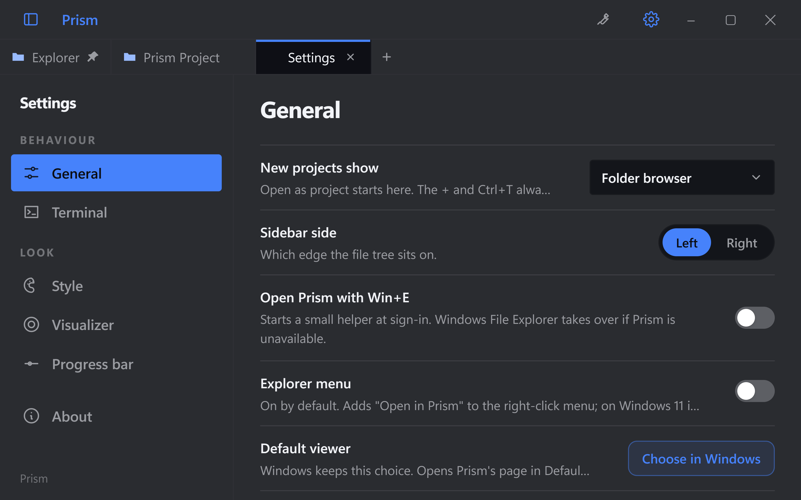
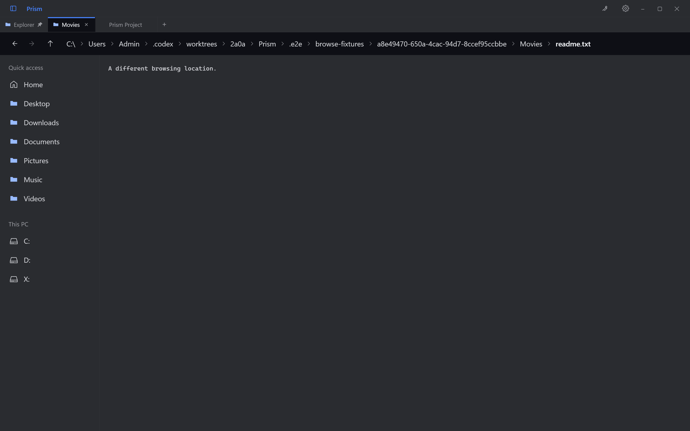

# Optional Windows Explorer shortcut

Settings > General > **Open Prism with Win+E** is off by default. Enabling it starts
a small Windows helper and registers that helper at sign-in for the current user.
Prism itself can close normally. Each distinct Win+E press opens a new Explorer
window, preserving existing windows and their open files. Holding the keys
does not create repeated windows.

The window shows a lightweight opening screen while the interface loads, with
working minimize, maximize and close controls. Loading feedback does not count
as a successful launch: the shortcut still waits for a rendered Explorer folder
before acknowledging readiness. Files opened during startup wait for the interface.

When Prism is already running, a Win+E press (or a folder opened through the
folder handler, #393) opens a new window of that same Prism, not a second Prism
(2026-10-29, tab tear-off step 2). The window opens on one Explorer tab: at the
folder the request names, otherwise at Settings > Explorer > Folder for new tabs
when that is a folder, otherwise Home. Its page acknowledges the helper as before:
"started" at once, the ready line once its folder shows. When Prism is not running,
the request opens Prism itself, as it always did. Every window shares one
preference store, listing cache and search index, so a setting changes in all of
them at once. Each window keeps its own tabs and their browsing grants, and saves
its own strip (the last window closed is what the next start opens).

Up to 0.120 each extra window was a separate Prism process on a working profile of
its own under `explorer-windows\` in Prism's folder. Those profiles are removed once,
shortly after the first start of a newer Prism.

The setting reads Windows state, confirms changes, and reports failures. It is
available only in packaged Windows builds. A different Prism installation or
profile cannot take ownership until the existing owner disables the setting.

The helper intercepts only plain Win+E. Other keys and modified combinations pass
through. Start-menu suppression uses an unassigned key rather than injecting Ctrl,
so it does not synthesize another application's Ctrl+Win shortcut. It does not log
keys or replace Explorer associations, system files or
Windows shortcut registry mappings. Disabling the setting stops the helper and
removes only its own startup entry. A normal uninstall does the same; upgrading
pauses the helper and preserves opt-in for Prism's next launch.

If Prism fails to launch or does not acknowledge a rendered Explorer folder within
eight seconds, the helper launches Windows File Explorer. If Prism or its resources
disappear, the helper stops interception and removes its owned startup entry on its
next lifecycle check. If the helper is stopped, crashes, or is absent, Windows keeps
its native Win+E behavior. Deleting an inactive installation can leave a harmless
startup entry pointing at a missing helper; that entry cannot intercept Win+E.

Explorer tabs never repeat the active filename in the title bar, including full-file
view with places collapsed. (Every tab is an Explorer tab since 2026-10-26; the old
project-tab title rule went with the project tabs.)

## Verification

- `npm run test:win-e` builds the helper and exercises ownership, disable, deletion,
  upgrade pause, literal Windows argument quoting and real named-pipe ACK/timeouts.
  It uses temporary registry keys and never remaps the actual desktop shortcut.
- Unit tests cover default-off startup, confirmed setting changes, serialization,
  failed-state readback and queued startup/renderer handshakes.
- Explorer Playwright tests exercise the General setting with mocked Windows state,
  titlebar visibility, cold startup (`folderOpen`) and requests while Prism runs
  (`folderOpenRunning`), over a stand-in for the helper's named pipe, without a hook.
- `folderOpenRunning` checks that a request while Prism runs opens one window more
  in the SAME process (one Prism main process on the profile, read from the process
  list), that the helper gets "started" then the id, and that the new window shows
  the asked folder, or the folder for new tabs for a plain Win+E.
- The owner confirmed the physical shortcut and chosen style with the current test
  build. Sign-in, crash-hook removal and installed upgrade/uninstall still need
  dedicated lifecycle verification; the automated checks do not claim those cases.

Native implementation and build details: [helper reference](../native/win-e/README.md).

